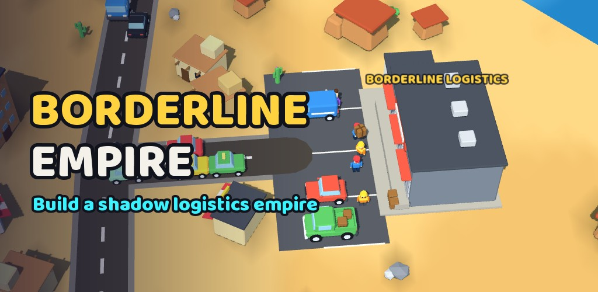

# Borderline Empire

*Working title. Rename it in `data/config.json` (`title`) and `project.godot` (`config/name`).*

A hybrid-casual **shadow-logistics tycoon** for Android and iOS, built in **Godot 4.7.2** with
low-poly 3D assets generated in **Blender**. Start with one rusty hatchback in a dusty garage
and grow it into an underground delivery empire across eight fictional regions.

> Everything in the game is fictional and abstract: made-up countries, made-up goods, and
> risk shown only as numbers ("Risk 42%", "Heat 65").



## Play it

1. Open the folder in **Godot 4.7.2+** (Project Manager → Import → `project.godot`).
   The first open imports every model, icon and sound.
2. Press **Play** (F5). The game runs in a portrait window, and the mouse acts as a finger.

| Action | Touch | Desktop |
|---|---|---|
| Pan | drag | drag · WASD / arrow keys |
| Zoom | pinch | mouse wheel · `+` / `-` |
| Rotate (±35°) | two-finger twist · ⟲ ⟳ buttons | right-drag · `Q` / `E` · `R` resets |
| Select | tap vehicles, HQ, locked regions | click |

## The loop

Contract arrives → Accept → choose vehicle and route (Fast / Normal / Safe) → watch the
delivery → resolve random events → unload and get paid → upgrade vehicles, garage and business
→ unlock new regions → build depots → automate → **prestige**.

- **Contracts:** 12 categories, 6 modifiers, plus a live offer feed.
- **Fleet:** 10 vehicles with 8 upgrades each. Drivers have rarity and levels.
- **Heat:** tracked per region. 12 random events. Failure states.
- **Progression:** 5 HQ levels, 10 business upgrades, 10 empire stages, endless goals.
- **Automation:** 4 steps — Auto Accept → Auto Assign → Auto Dispatch → Regional Manager — plus
  regional depots.
- **Influence** (second currency): earned from cross-border runs, goals, stages and regions.
  Spend it on permanent **Connections** perks.
- **Prestige** (from the "Empire" stage): start a new run and keep **Legacy Stars**. Each
  star gives +10% income and a bigger starting fund.
- **Regions:** each has its own themed crossing (classic booth, adobe gate, alpine cabin, port
  gantry, industrial yard, neon checkpoint) and its own biome.
- **Session tools:** offline and resume progress, autosave with corrupted-save recovery.

### Onboarding

On first launch a short cinematic intro plays with **Dot**, a retired dispatcher. The
intro has letterbox bars, typewriter dialogue and voice-over. You name your company and pick
its colour, and both appear on the HQ sign and your first car. Dot then guides your first
contract, dispatch and upgrade through the contextual tutorial. The bottom tabs unlock one by
one as you progress, each with a *NEW* badge and a hint. The intro can be skipped. Settings can
skip the tutorial or replay the intro, which also lets you rename the company.

## Languages

English, Turkish, German, Spanish, French, Japanese, Korean, Portuguese, Russian and Simplified Chinese. The game follows the device language; Settings provides a persistent language picker.

- Strings live in `translations/strings.csv`; Godot imports it into `.translation` files.
  The keys are the English text.
- `python tools/i18n/extract_strings.py` collects every `tr()` / UI string from scripts and
  JSON. `NITROROUTER_API_KEY=... python3 tools/i18n/translate_api.py` fills missing translations with NitroRouter `gpt-6-luna` (owner-approved fallback because 6.1 Luna is unavailable on the cheap group). Run `python3 tools/i18n/validate.py` before shipping.
- `UIKit.upper()` handles Turkish casing (i → İ, ı → I). `UIKit.pl()` drops the English plural "s".
- The UI font is **Baloo 2** (SIL OFL, `assets/fonts/OFL-Baloo2.txt`), which supports the full
  Turkish alphabet. Bundled Noto Sans CJK covers CJK and Cyrillic without depending on system fonts.

## Project layout

```
assets/      models (GLB from Blender), textures (8x8 palette), shaders, icons (SVG), audio, fonts
data/        all balance & content as JSON (regions, vehicles, contracts, events, upgrades,
             drivers, progression, connections, onboarding, ...)
scenes/      main.tscn (entry), ui/hud.tscn
scripts/
  core/        GameManager, SaveManager, EventManager, AudioManager, Data, ModelLibrary, DebugTools
  economy/     EconomyManager
  contracts/   ContractManager (offers, queue, jobs, automation)
  vehicles/    VehicleManager (fleet, upgrades, drivers), VehicleActor (3D)
  world/       RegionManager + RoadGraph, HeatManager, World, RegionView, HQSite, CameraRig,
               CharacterActor, terrain, traffic
  progression/ ProgressionManager (garage, business, stages, goals, influence, prestige),
               TutorialManager
  ui/          HUD, bottom sheets, modals, onboarding, tutorial overlay, UIKit theme
  effects/     pooled particle FX, delivery unload sequence
translations/ strings.csv (10 locales)
store/       app icons, store screenshots (EN / TR), feature graphic, listing text, privacy policy
tools/       blender/, audio/, i18n/, store/
tests/       headless gameplay test (a bot plays 45 simulated minutes)
```

Game logic lives in autoload managers that communicate through signals. The 3D world and UI
only observe them, so the simulation can be tested headlessly.

## Asset pipeline

```bash
python tools/palette.py                       # 8x8 colour palette texture
blender -b -P tools/blender/build_assets.py   # or: python tools/blender/build_assets.py (bpy module)
```

Every model is UV-mapped onto the palette, so the whole world renders with **one shared
material**. Each vehicle swaps its paint cell. Characters (driver, worker, passenger, VIP, the
mentor) use rigid limbs that `CharacterActor` animates procedurally (idle, walk, carry, wave,
talk).

### Audio (ElevenLabs)

```bash
export ELEVENLABS_API_KEY=...                 # never commit the key
python tools/audio/elevenlabs_voice.py        # announcer + mentor lines, EN and TR
python tools/audio/elevenlabs_voice.py --sfx  # AI sound effects
python tools/audio/elevenlabs_voice.py --music
python tools/audio/postprocess.py             # trim silence + normalise loudness (ffmpeg)
```

Voice lines go to `assets/audio/voice/<lang>/<key>.mp3`. `AudioManager.voice()` picks the
current language. Music loops are crossfaded into seamless OGG files.
`tools/audio/make_sfx.py` is the offline fallback synth.

## Tests and CI

```bash
godot --headless --import            # first run only
godot --headless res://tests/test_runner.tscn
```

The test plays the first delivery. A bot then runs 45 simulated minutes, and the test checks
progression, influence, connections, prestige, save/load, corrupted-save recovery and offline
progress. It also prints a milestone pacing report. `.github/workflows/tests.yml` runs the
same test on every push and pull request, after validating every JSON data file.

Quality pass 2026-10-18 added (evidence: `docs/qa/quality-2026-10-18/NOTES.md`):

```bash
godot --headless res://tests/lifecycle_test.tscn           # first launch, restart, background, language switch, onboarding Skip,
                                                          # boot curtain / 60 fps cap / gl_compatibility, text >= 11 pt, touch >= 44 pt, no free trial
SCAN_LANGS="de ru" godot --headless -s tests/tool_layout_scan.gd   # text-overflow scan (every panel x language; Jenkins runs en de ru pt)
godot --headless -s tests/tool_monkey.gd                   # random-action monkey (env MK_SEED, MK_SECONDS, MK_SPEED)
godot --path . --resolution 540x960 -s tests/tool_perf_tiers.gd -- --out=/abs/dir --stage=midgame   # needs a GPU window
SCAN_LOCALE=ja godot --headless -s tests/tool_untranslated_scan.gd   # English text left in a non-Latin locale
```

The game starts in `scenes/boot/boot.tscn`: a loading curtain (the game's own icon, a real progress bar, translated
tips) that preloads `main.tscn` and the model GLBs on worker threads, and the phone power profile
(`Engine.max_fps = 60` on Android / iOS).

## Store assets

`store/` holds everything a store listing needs:

- App icons: 1024, 512, 192, 180, 167, 152, 120, 76, plus Android adaptive foreground and
  background layers.
- Six captioned phone screenshots per language (1080×1920).
- A 1024×500 feature graphic.
- `listing_en.md` / `listing_tr.md` and `privacy_policy.md`.

To regenerate them:

```bash
godot --rendering-driver opengl3 res://tools/store/icon_render.tscn   # 3D icon layer
GODOT=godot tools/store/shoot_screens.sh                             # raw shots → captioned screenshots
```

Raw screenshots come from the QA arguments in `scripts/core/debug_tools.gd`, for example
`godot -- --qa --shot=out.png --lang=tr --panel=contracts`. They are only active when such
arguments are passed.

## Mobile notes

- **Renderer:** GL Compatibility, for the widest Android/iOS support.
- **Rendering cost:** MultiMesh props, one palette material, tiny textures.
- **Pooling:** effect bursts, floating text, coins, unload crates and traffic are pooled.
- **Physics:** none.
- **Quality presets** (Low / Medium / High, in Settings): real-time shadows and their
  resolution, MSAA, blob shadows on Low, and traffic density.
- **Baked lighting:** ambient-occlusion contact shadows are baked into tile vertex colours,
  so they cost nothing at runtime.

Export presets for Android and iOS ship with the generated icons. Install the export templates
and set up signing before exporting.

## Completion audit

See [PLAN.md](PLAN.md) for implementation evidence and release prerequisites.
See [CLAUDE.md](CLAUDE.md) for project rules. QA scenes and `--qa` runs use
`user://qa/`; normal saves are not touched. The UI uses a minimum 88×88 logical
touch target on a 720-wide canvas, animated onboarding with explicit progression,
and Light/Dark/System appearance. Narration is recorded in EN/TR only; other
locales display translated text without playing a mismatched voice.

`python3 tools/qa_mobile.py` captures actual panels at phone resolution and checks
button bounds. Screenshots are local generated evidence, excluded from exports.


## Monetization and native builds

Optional rewarded ads and a one-time Empire Pass are implemented through Poing
AdMob and Godotx RevenueCat. Live provisioning was explicitly deferred by the owner.
Configure only app-specific public SDK keys in `data/monetization.json`; never put
RevenueCat secret keys in the mobile bundle. Store prices come from the native SDK.
Run `python3 tools/check_release.py` before a production export. It currently blocks
on missing live configuration, signing and sandbox evidence, intentionally.

`tools/native/setup_ios.sh` restores the checksum-pinned RevenueCat iOS frameworks
via the Mac Mini. They are not checked into Git. Android debug export uses the
Godot Gradle template: `sh tools/build_android.sh --apk` (debug APK, Google test ad units). Release builds
(signed AAB / App Store archive, real AdMob units) run from Jenkins `Games/smuggler-mobile` — see `jenkins/` and
`tools/build_android.sh` / `tools/build_ios.sh`.

## Firebase Analytics

`coddykit-game` hosts both platform registrations for `com.coddykit.borderlineempire`
(app/bundle id since 2026-10-09; the old `com.borderlineempire.game` registrations are unused).
Core + Analytics use godot-x/firebase 3.1.0, with a Gradle export hook that applies
Google Services. iOS frameworks are restored by `tools/native/setup_ios.sh`.
`Analytics` initializes after native Core; analytics storage is granted and all
advertising consent signals remain denied. QA/test runs never initialize the SDK.
Automatic session events are supplemented by `game_ready`, `screen_view`,
`delivery_completed` and `tutorial_complete`; no company name or saved game is sent.

GA4 property/stream mappings are recorded in `docs/firebase-registration.json`.
Before public distribution, record the App Privacy and Play Data Safety Analytics
declarations in `docs/analytics-store-declarations.json`; the release checker
requires `ios.analytics_declared` and `android.analytics_declared` to be true.
Do not mark these true until the actual store forms have been verified.
